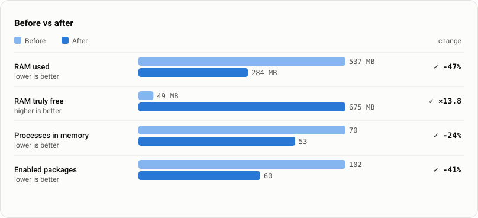
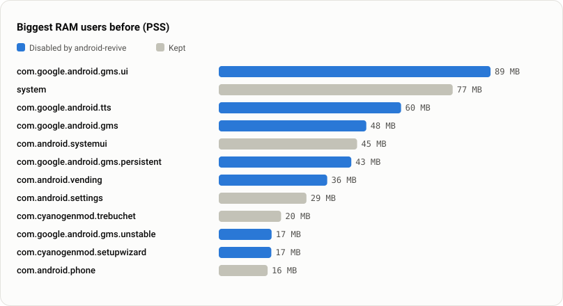

# android-revive

**Bring an old Android phone or tablet back to life, safely, with an AI agent at the wheel and numbers to prove it.**

android-revive is an [Agent Skill](https://docs.claude.com/en/docs/claude-code/skills) for Claude Code (and a plain
Python CLI you can use without any AI). It walks you through preparing the device, measures it, removes
what slows it down, checks it still boots, and gives you a before/after report. Every change can be undone
with one command.

- 🔒 **It can't brick your device.** It only uses reversible operations. It never roots, flashes or deletes
  anything, and a hard-coded never-touch list protects the parts Android can't run without.
- ↩️ **Every change can be undone.** Each change is written to `rollback.sh` *before* it's executed. You can
  roll back everything, or one app at a time, even without Python.
- 📊 **You see the before and after.** RAM, processes, app start time, scroll smoothness and boot time are
  measured under the same conditions before and after, and you get an HTML report plus SVG charts.
- 🧭 **It guides you the whole way:** backup, removing your accounts (to avoid the FRP lock), factory reset,
  Developer options, USB debugging. It's written for people who've never opened a terminal.

---

## The case that started it: a 2015 tablet

A **Samsung Galaxy Tab E 9.6 (SM-T561)** from 2015 had sat in a drawer for years: 1.5 GB of RAM, a 32-bit
CPU, and an unofficial LineageOS 14.1 (Android 7.1.2) build with Google apps. It was unusable: 49 MB of free
RAM at idle, and Google Play services alone took more than 190 MB.

The goal was a **wall dashboard** (weather, markets, appointments), a single-purpose device, so Google
services could go too (`aggressive` tier plus `--allow-extreme`). 41 packages were disabled.



| | Before | After | |
|---|---:|---:|---:|
| RAM used | 537 MB | **284 MB** | −47% |
| RAM truly free | 49 MB | **675 MB** | ×13.8 |
| Processes in memory | 70 | **53** | −24% |
| Enabled packages | 102 | **60** | −41% |

Where the memory was going: 7 of the 12 biggest RAM users were Google services and a setup wizard that had
finished years earlier.



The tablet now runs a small Python server and a full-screen dashboard 24/7, and it's reachable over SSH.

<sub>About the method: this case was measured by hand with `dumpsys meminfo`, before the tool existed. The
"before" was taken about 9 minutes after setup and the "after" about 2 minutes after a reboot. The raw dumps
are in [`docs/case-sm-t561/`](docs/case-sm-t561), and the charts were generated from them by
`revive.py report`. The tool now measures before and after under identical conditions (`measure --boot`:
fresh reboot plus a 90 s settle) and adds app start, scroll jank and boot time.</sub>

---

## How it works

```
 Phase 0  Goal           what will the device be used for? → picks how aggressive to be
 Phase 1  Preparation    charge · backup · remove accounts · (factory reset) · USB debugging   ← you, guided
 Phase 2  Baseline       preflight → recon → measure --label before --boot
 Phase 3  Plan           debloat (dry run)  → you approve / strike items
 Phase 4  Apply          debloat --apply (batches of 5 + health check) → tune → guard --reboot
 Phase 5  Result         measure --label after --boot → report (HTML + SVG + markdown)
 Any time Rollback       rollback · rollback --package X · sh rollback.sh
```

### Safety, in detail

| Risk | What android-revive does |
|---|---|
| Removing something Android needs | `never-touch.txt` (System UI, Settings, package installer, providers, Knox, MIUI security…), enforced by the script, no override |
| Losing the home screen, keyboard, WebView | Detected live on *your* device (whatever handles HOME, the current keyboard and WebView, the default SMS and phone apps, accessibility services, device admins) and protected |
| A phone that can't call anymore | On devices with telephony, the dialer, SMS, contacts and **emergency alerts** are locked unless you pass `--allow-telephony` |
| Breaking every app | Google Play services and the Play Store sit in a separate `extreme` tier that needs an explicit flag |
| A bad change going unnoticed | Changes go in batches of 5, and after each batch it checks that the shell, package manager, System UI, launcher, keyboard and WebView are fine. If not, **that batch is reverted automatically** |
| A device that no longer boots | `guard --reboot` proves it boots. If it doesn't, adb normally still works during boot, so the rollback runs and [troubleshooting](skills/android-revive/references/troubleshooting.md) covers safe mode and recovery |
| Being interrupted halfway | Write-ahead journal: the undo command is written *before* each change, so a rollback is correct at any moment |
| Irreversible removal | Default `pm disable-user`. `pm uninstall -k --user 0` is opt-in and only allowed on Android 8+, where `install-existing` restores it. Nothing on `/system` is touched |
| FRP lock after a reset | `preflight` warns when Google accounts are still on the device, and the guide removes them before any reset |

### Debloat tiers

| Tier | What's in it | For |
|---|---|---|
| `safe` | telemetry, ads, easter eggs, stubs, Facebook preinstalls | everyone |
| `recommended` | Bixby, Game Launcher, Mi Video, Duo, Play Movies, Samsung Cloud… | most people |
| `aggressive` | gallery, calendar, calculator, edge panels, TalkBack… | single-purpose devices |
| `extreme` | Google Play services, Play Store (needs `--allow-extreme`) | kiosks and wall displays with no Google apps |

The lists cover AOSP, LineageOS, Google, Samsung, Xiaomi and common preinstalls (`skills/android-revive/lists/`).
The format is one line per app: `package | tier | what it is`.

---

## Install

### With Claude Code (recommended)

```
/plugin marketplace add AlfDev1996/android-revive
/plugin install android-revive@android-revive
```

Or copy the skill folder by hand:

```bash
git clone https://github.com/AlfDev1996/android-revive
cp -r android-revive/skills/android-revive ~/.claude/skills/
```

Then plug in the device and say: *"I have an old Samsung tablet, help me make it fast again"*.
The agent drives the whole flow, explains each step and asks before changing anything.

### Without AI (plain CLI)

You need Python 3.9+ and adb (`brew install android-platform-tools` · `sudo apt install adb` · Windows:
[platform-tools](https://developer.android.com/tools/releases/platform-tools)).
Read the [preparation guide](skills/android-revive/references/prep-guide.md) first.

```bash
R=android-revive/skills/android-revive/scripts/revive.py
python3 $R preflight
python3 $R recon
python3 $R measure --label before --boot
python3 $R debloat --tier recommended            # dry run: read the plan
python3 $R debloat --tier recommended --apply
python3 $R tune --apply
python3 $R guard --reboot
python3 $R measure --label after --boot
python3 $R report                                # → android-revive-sessions/<device>/report.html
```

Undo:

```bash
python3 $R rollback                              # everything
python3 $R rollback --package com.android.email  # one app
sh android-revive-sessions/<session>/rollback.sh # no Python needed (rollback.cmd on Windows)
```

### What a session folder contains

```
android-revive-sessions/SM-T561-20261107-091000/
├── recon.json            device, packages, what's protected and why
├── measure-before.json   ┐
├── measure-after.json    ┘ metrics
├── snapshot.json         state of every package and setting before any change
├── actions.jsonl         write-ahead journal of every change
├── rollback.sh / .cmd    undo scripts, always up to date
├── report.html           the before/after report
├── summary.md            markdown table, ready to paste
└── charts/*.svg          the charts, light and dark
```

---

## Commands

| Command | Does |
|---|---|
| `preflight` | adb present, device authorized, Android ≥ 5.0, battery, Google accounts (FRP), root |
| `recon` | starts a session: device facts, all packages, dynamic protection list |
| `measure --label before\|after [--boot] [--quick]` | RAM, processes, packages, storage, Settings cold start, scroll jank, boot time |
| `snapshot` | full package and settings state (taken automatically before the first change) |
| `debloat [--tier] [--apply] [--keep …] [--only …] [--list file] [--method uninstall] [--allow-extreme] [--reapply]` | the plan, then reversible batches |
| `tune [--animations fast\|off\|keep] [--keep-scans] [--trim-caches] [--compile] [--apply]` | animation speed, background Wi-Fi/BT scanning, cache trim, AOT compilation |
| `guard [--reboot]` | health check, reboot test, and any apps the system re-enabled on its own |
| `rollback [--package …] [--to-snapshot]` | undo |
| `status` · `report` | session overview · HTML/markdown/SVG report |

## Testing

### Tested on

| Device | Android | What was verified |
|---|---|---|
| Samsung Galaxy Tab E 9.6 (SM-T561), LineageOS 14.1 | 7.1.2 (API 25) | preflight, recon, measurements, apply → health check → rollback on a real device |
| Android Emulator (Google APIs, x86_64) | 14 (API 34) | full cycle: 28 packages disabled, tune, reboot test, report, full rollback, uninstall/restore round trip; package state identical at the end |

Tested a different device? Please open an issue with your `summary.md`.

### Automated

`tests/fake_adb.py` simulates a device, so the whole cycle runs in CI without hardware. That covers the full
cycle plus rollback, `rollback.sh` on its own, a broken batch being reverted automatically, the telephony
lock, the extreme tier and never-touch, re-enabled apps, and the uninstall/restore round trip:

```bash
python3 -m unittest discover tests
```

`tests/emulator.sh` runs the same flow on real Android emulators (API 24/29/34) for anyone with the Android SDK.

## Contributing

The lists matter most. Tested a device? Open an issue with the model, Android version, tier used and
`summary.md`. To move a package to a riskier tier, or out of never-touch, you need a real-device report.

## Disclaimer

Every change android-revive makes is reversible and it's been designed not to break devices, but it comes
with no warranty (MIT). Back up first. That's why the guide starts there.

## License

MIT © AlfDev1996
